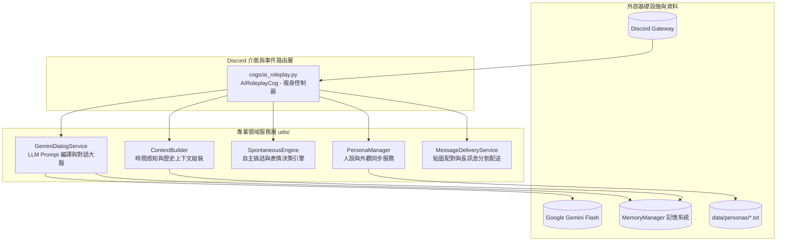
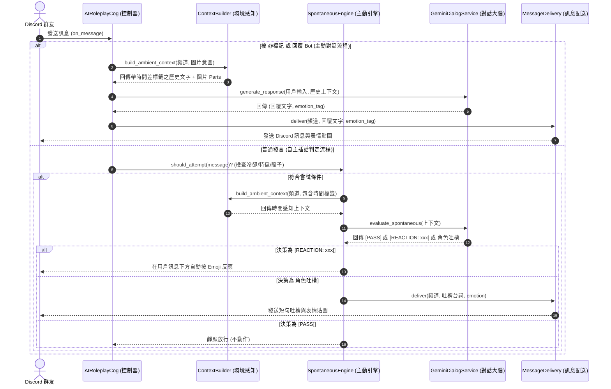

# 🏛️ AI Roleplay 模組物件導向 (OOP) 與職責分離重構方案

> **文件定位**：軟體架構分析與重構解決方案設計書 (Architectural Refactoring Proposal)  
> **目標對象**：[`cogs/ai_roleplay.py`](file:///d:/OneDrive/tools/dc_auto_bot/cogs/ai_roleplay.py)（現有 1,134 行巨石類別）  
> **核心目標**：採用**單一職責原則 (SRP)** 與**分層架構 (Layered Architecture)**，將混雜在單一檔案中的 8 大職責解耦拆分，消除上帝物件 (God Object)，提升可維護性、可測試性與未來功能擴充能力。

---

## 📊 1. 現況診斷與架構痛點 (Current State Analysis)

### 1.1. 現行架構反模式：上帝物件 (God Object)
目前 `AIRoleplayCog` 單一類別同時承擔了以下互相耦合的領域邏輯：
1. **Discord 交互層**：事件監聽 (`on_message`)、斜線指令 (`/chat`, `/chg_persona`, `/bot_info`)、自動補全。
2. **人設與外觀管理**：人設檔案載入、快取、伺服器暱稱修改、Discord 頭貼自動下載與套用。
3. **歷史與時間上下文構建**：抓取歷史紀錄、相對時間差計算、沉寂斷層線插入、回覆目標引文提取。
4. **多模態視覺意圖處理**：圖片意圖關鍵字偵測、附件/頭像圖片下載與 GenAI `types.Part` 轉換。
5. **自主插話與表情反應引擎**：四層防洗版漏斗、冷卻時間狀態追蹤、`[PASS]` / `[REACTION]` 決策分發。
6. **Gemini LLM 對話核心**：Prompt 組裝、System Instruction 編譯、模型呼叫與例外重試。
7. **記憶模組串接**：與 `MemoryManager` 的雙層文化/用戶畫像進行上下文橋接。
8. **訊息配送與貼圖包裝**：長訊息 2,000 字元切割發送、Emotion PNG 貼圖配對。

### 1.2. 痛點影響評估
* **修改風險高（高偶合）**：修改主動插話的表情正則，可能非預期波及一般對話發送或人設切換。
* **難以進行單元測試**：業務邏輯與 `discord.ext.commands.Cog` 強度綁定，無法在不啟動 Discord Gateway 的情況下測試時間計算或提示詞組裝。
* **程式碼可讀性低**：單檔超過千行，新功能維護與除錯需跨越數百行程式碼查找依賴。

---

## 🏛️ 2. 目標架構設計 (Target OOP Architecture)

重構將採用 **「控制器-服務層 (Controller-Service Layer)」** 設計模式：
* **Cog (Controller)**：回歸為純粹的「Discord 事件路由器與 UI 接收端」（行數降至約 150~200 行）。
* **Services / Domain Objects**：各專業領域邏輯獨立封裝為純 Python 類別，置於 `utils/` 目錄。

---

## 🧩 3. 模組拆解與職責分配表 (Component Blueprint)

| 模組路徑 | 負責類別 / 檔案 | 核心職責 (Single Responsibility) | 與外部之依賴關係 |
| :--- | :--- | :--- | :--- |
| [`cogs/ai_roleplay.py`](file:///d:/OneDrive/tools/dc_auto_bot/cogs/ai_roleplay.py) | `AIRoleplayCog` | **純事件轉發與指令控制器** • 註冊 Slash Commands (`/chat`, `/chg_persona`) • 監聽 `on_message` 並根據提及/回覆/普通對話分發給對應 Service • 控制 `KeepTyping` 打字中狀態 | 依賴後方各 Service 物件 |
| `utils/persona_manager.py` | `PersonaManager` | **人設與外觀資產管理器** • 載入、快取與熱切換 `data/personas/` 中的 txt 檔案 • 提供可選人設清單供 Autocomplete 使用 • 處理 Discord 伺服器暱稱修改與角色頭像更新 | 依賴本地檔案系統、VIP 設定檔 |
| `utils/context_builder.py` | `ContextBuilder` | **上下文與多模態環境感知器** • 抓取頻道歷史（滑動 30 則） • 計算相對時間差標籤（`[剛才]`、`[2小時前]`） • 插入沉寂斷層線（`--- ⏳ 沉寂 X 小時 ---`） • 解析被回覆訊息（目標文字與引用圖片） • 偵測圖片意圖並下載歷史/頭像圖片為 `types.Part` | 依賴 `discord.py`、Google GenAI `types` |
| `utils/spontaneous_engine.py` | `SpontaneousEngine` | **自主插話與表情反應決策引擎** • 管理每頻道 60 秒冷卻狀態機 • 執行本地零成本特徵過濾（角色名、內部梗、熱詞、機率骰） • 組裝專屬自主決策提示詞 • 解析 AI 決策標籤（`[PASS]` 放行、`[REACTION]` 表情點擊、文字吐槽） | 依賴 `ContextBuilder`、`GeminiDialogService`、`MemoryManager` |
| `utils/gemini_dialog_service.py` | `GeminiDialogService` | **LLM 生成與對話核心大腦** • 整合 `MemoryManager` 雙層記憶注入 System Instruction • 維護頻道 16 輪歷史對話狀態快取 (`channel_histories`) • 封裝 Google GenAI `models.generate_content` 調用與例外容錯 | 依賴 Google GenAI SDK、`config.py` |
| `utils/message_delivery.py` | `MessageDeliveryService` | **訊息配送與表現層封裝** • 檢查 AI 回覆中的 `[EMOTION: xxx]` 並配對 `assets/emotions/*.png` • 超過 Discord 2,000 字元限制時自動智慧分段 • 執行文字安全清洗（去除多餘引號、角色名標籤） | 依賴 `discord.File`、本地資產目錄 |

---

## 🔄 4. 訊息處理核心時序流程 (Collaborative Workflow)

---

## 🚀 5. 分階段平滑遷移藍圖 (Phased Migration Roadmap)

為了確保在重構過程中**不停機、不破壞現有功能、零 Regression（防倒退）**，建議採取 4 階段漸進式重構：

### 階段一：純粹工具類抽取（風險：🟢 低）
* **動作**：
  1. 建立 `utils/message_delivery.py`：將 2,000 字元切割、Emotion 圖片載入、文字前綴清理抽取成獨立工具。
  2. 建立 `utils/persona_manager.py`：將檔案清單搜尋、人設檔案讀取、暱稱與頭像換裝邏輯搬遷。
* **驗證**：測試人設切換指令 `/chg_persona` 與表情貼圖發送是否正常。

### 階段二：環境上下文與多模態抽取（風險：🟡 中）
* **動作**：
  1. 建立 `utils/context_builder.py`：搬遷 `fetch_recent_channel_context`、相對時間計算、沉寂斷層線、圖片意圖判定。
* **驗證**：測試對話時的歷史背景理解與多模態看圖對話。

### 階段三：主動插話與對話大腦解耦（風險：🟡 中）
* **動作**：
  1. 建立 `utils/spontaneous_engine.py`：獨立封裝冷卻時間字典、特徵篩選、正則 Emoji 反應與插話決策。
  2. 建立 `utils/gemini_dialog_service.py`：將核心對話生成與 System Instruction 組裝獨立。
* **驗證**：測試主動插話、Emoji 反應、`[PASS]` 靜默以及 `@Bot` 常規對話。

### 階段四：瘦身控制器整合與全局驗證（風險：🟢 低）
* **動作**：
  1. 大幅精簡 `cogs/ai_roleplay.py`，內部改為持有上述 Service 實例進行依賴注入與流程調度。
  2. 清理無用之全域變數與冗餘輔助函式。
* **驗證**：執行完整端到端測試（對話、看圖、人設切換、記憶學習、主動插話）。

---

## 🛡️ 6. 重構關鍵設計原則與防雷指引 (Architectural Guidelines)

1. **避免循環依賴 (No Circular Imports)**：
   * 遵循依賴單向流動原則：`Cog (Controller)` ➔ `Service` ➔ `Utils / SDK`。
   * Service 之間若需共享資料（如 `MemoryManager`），透過依賴注入（Dependency Injection）在建構子中傳入。
2. **狀態保持 (State Preservation)**：
   * 頻道歷史快取（`channel_histories`）與冷卻時間（`spontaneous_cooldowns`）應安全封裝在對應 Service 的實例變數內，避免全域變數污染。
3. **介面純粹化 (Pure Python when possible)**：
   * 盡量讓 Service 處理純資料（字串、字典、二進位位元組），將 `discord.Interaction`、`discord.Message` 等 Discord 特有物件的解析留在 Controller 層，提升模組的可重用性。
