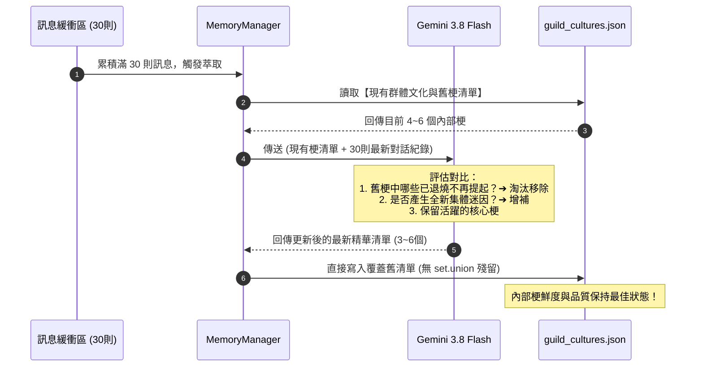

# 🧠 Inside Jokes 智慧動態汰換機制計畫書 (方案 A)

> **專案**：`dc_auto_bot`  
> **目標模組**：[`utils/memory_manager.py`](file:///d:/OneDrive/tools/dc_auto_bot/utils/memory_manager.py)  
> **核心目標**：解決目前內部梗（`inside_jokes`）只有單向增加（聯集）而永不淘汰、導致滿 8 個後隨機截斷的痛點。改採**「方案 A：AI 智慧全動態維護（保留核心、淘汰過期、收錄新梗）」**，將維護裁量權交由 Gemini 決策，維持社群梗的鮮度與代表性。  
> **文件用途**：供後續對話或開發者依循此規格進行代碼修改與測試。

---

## 📌 1. 現狀痛點與重構動機

### 1.1. 現行邏輯問題分析
在 [`utils/memory_manager.py`](file:///d:/OneDrive/tools/dc_auto_bot/utils/memory_manager.py) 第 248~254 行：
```python
# 舊邏輯：強制聯集 + 盲目截斷
existing_jokes = set(self.guild_cultures[guild_id].get("inside_jokes", []))
new_jokes = set(culture_data.get("inside_jokes", []))
combined_jokes = list(existing_jokes.union(new_jokes))[:8]  # Keep top 8 jokes
self.guild_cultures[guild_id]["inside_jokes"] = combined_jokes
```
* **永生不死**：即使 Gemini 判定某個梗過期而未在本次回傳，Python 代碼層仍透過 `set.union` 強行將舊梗加回。
* **無序隨機丟失**：Python 的 `set` 無順序保證，滿 8 個時執行 `[:8]` 截斷會造成熱門新梗被隨機丟棄、過期冷梗反而被留下的反常現象。

---

## 🛠️ 2. 方案 A 核心設計與修改規範

### 2.1. 提示詞升級 (Prompt Enhancement)
在 `utils/memory_manager.py` 的 `extraction_prompt` 中，將「單純提取新梗」升級為**「全生命週期動態維護（審核舊梗 + 淘汰冷門 + 增補新梗）」**：

* **審核原則**：
  1. **保留**：群友仍經常提起、或具備長期高度共鳴的核心梗。
  2. **淘汰移除**：若某個舊梗已經時過境遷、最近數輪對話完全無人提起、或重要性下降，**直接將其從清單中移除淘汰**。
  3. **收錄新梗**：符合「多人參與 + 集體吐槽/自嘲/迷因屬性」的新話題才予加入；若無新梗或對話平淡，維持現有精華或回傳空陣列。
  4. **數量收斂**：要求最終回傳的清單維持在 **3 ~ 6 個最具代表性的核心梗**，精準而不冗餘。

### 2.2. Python 代碼修改 (Diff)
解除 `set.union` 硬合併，直接採納 AI 智慧評估後的最終清單：

```diff
             # 1. Update Guild Culture
             if "guild_culture" in result_data and isinstance(result_data["guild_culture"], dict):
                 culture_data = result_data["guild_culture"]
                 if guild_id not in self.guild_cultures:
                     self.guild_cultures[guild_id] = culture_data
                 else:
-                    # Merge inside jokes uniquely
-                    existing_jokes = set(self.guild_cultures[guild_id].get("inside_jokes", []))
-                    new_jokes = set(culture_data.get("inside_jokes", []))
-                    combined_jokes = list(existing_jokes.union(new_jokes))[:8]  # Keep top 8 jokes
-                    
+                    # 方案 A：直接採納 AI 動態維護與淘汰後的最新精華清單（最多保留 6 個）
+                    managed_jokes = culture_data.get("inside_jokes", [])
+                    if isinstance(managed_jokes, list):
+                        # 防禦性確保元素為字串且過濾空值
+                        cleaned_jokes = [str(j).strip() for j in managed_jokes if str(j).strip()][:6]
+                    else:
+                        cleaned_jokes = self.guild_cultures[guild_id].get("inside_jokes", [])
+
                     self.guild_cultures[guild_id]["group_vibe"] = culture_data.get("group_vibe", self.guild_cultures[guild_id].get("group_vibe", ""))
-                    self.guild_cultures[guild_id]["inside_jokes"] = combined_jokes
+                    self.guild_cultures[guild_id]["inside_jokes"] = cleaned_jokes
                     self.guild_cultures[guild_id]["speech_style"] = culture_data.get("speech_style", self.guild_cultures[guild_id].get("speech_style", ""))
                 
                 self._save_guild_cultures()
```

---

## 🔄 3. 完整執行流程 (Lifecycle Workflow)



---

## 🧪 4. 測試與驗證計畫

| 測試場景 | 操作方式 | 預期表現 |
| :--- | :--- | :--- |
| **1. 舊梗自動淘汰驗證** | 目前清單有舊梗「昨晚吃便當打翻」。接下來連續進行 30 則鳴潮抽卡大保底討論（完全不提便當）。 | 背景萃取後，檢視 `data/guild_cultures.json`，確認「昨晚吃便當打翻」已被**成功淘汰移除**。 |
| **2. 熱門新梗增補驗證** | 群友熱烈吐槽某個新事件並狂發迷因圖。 | 背景萃取後，新事件被**精準提煉為關鍵短語**並收錄在清單中。 |
| **3. 平淡日常不污染驗證** | 累積 30 則普通的早安問候與生活瑣事。 | AI 不會強湊新梗，清單維持現有核心梗或維持原樣，數量**嚴格收斂在 3~6 個以內**。 |
