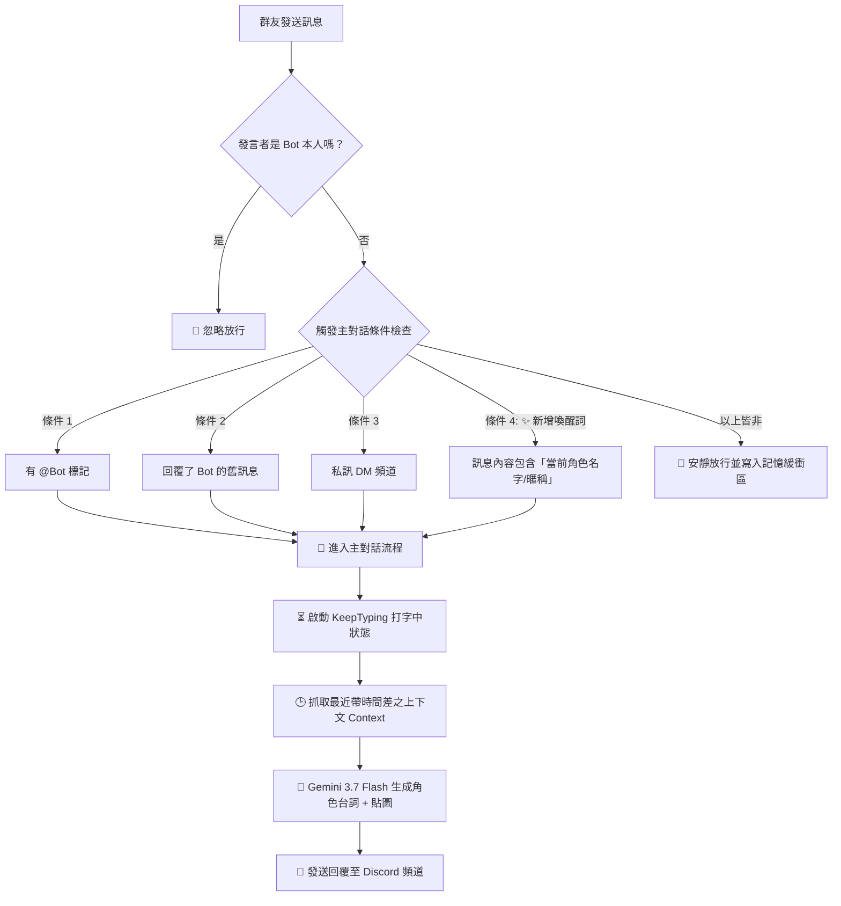

# 🎙️ 角色喚醒詞 / 名字關鍵字直接對話系統規格書 (Name-Wake Word Direct Dialogue)

> **專案**：`dc_auto_bot`  
> **目標模組**：[`cogs/ai_roleplay.py`](file:///d:/OneDrive/tools/dc_auto_bot/cogs/ai_roleplay.py)  
> **核心目標**：讓群友在聊天時只要打出「當前活躍角色的名字或暱稱（喚醒詞）」，Bot 就會直接視為主動對話並即時回覆（帶有打字中提示與表情貼圖），無須死板地輸入 `@Bot`，實現如真人朋友在身邊般的極致流暢體驗。  
> **文件用途**：供後續對話或開發者依循此規格進行功能開發與測試。

---

## 📌 1. 核心需求與特色

1. **確定性即時回覆 (Deterministic & Instant)**：
   * 只要訊息中包含當前角色的名字/暱稱，100% 進入主對話流程，啟動 `KeepTyping` 並秒回。
2. **動態人設專屬喚醒詞 (Dynamic Per-Persona Aliases)**：
   * 只有**當前正在使用中的角色**之喚醒詞會生效，避免角色錯亂。
3. **完全零擾民、零冷卻死鎖**：
   * 沒叫名字時 100% 保持安靜，徹底告別過去隨機插嘴猜測所帶來的延遲與誤回問題。

---

## 📋 2. 五大活躍角色專屬喚醒詞對照表

系統會依據目前載入的 `self.current_persona_name` 動態匹配以下喚醒詞清單（不分大小寫）：

| 角色設定檔 | 角色名稱 | 支援喚醒關鍵字 / 暱稱 (Aliases) | 說明 |
| :--- | :--- | :--- | :--- |
| `persona_aemeath.txt` | **愛彌斯 (Aemeath)** | `["愛彌斯", "aemeath", "小愛"]` | 🌟 特別備註：愛彌斯的小名為 **「小愛」** |
| `persona_mornye.txt` | **莫寧 (Mornye)** | `["莫寧", "mornye", "莫寧教授"]` | 《鳴潮》黑石研究員 |
| `persona_default.txt` | **愛莉 (Airi)** | `["愛莉", "airi", "愛莉希雅"]` | 活潑粉髮少女 |
| `persona_daniya.txt` | **達妮婭 (Daniya)** | `["達妮婭", "daniya"]` | 冷靜優雅的戰術指揮 |
| `persona_liino.txt` | **梨諾 (Liino)** | `["梨諾", "liino"]` | 俏皮可愛的探險夥伴 |

---

## 🏛️ 3. 執行流程圖 (Workflow)



---

## 🛠️ 4. 具體代碼實現規格 (`cogs/ai_roleplay.py`)

### 4.1. 新增動態別名取得函式
在 `PersonaManager` 或 `AIRoleplayCog` 中提供別名清單：

```python
    def get_active_persona_aliases(self) -> List[str]:
        """Return list of wake-word aliases corresponding to the currently active persona."""
        current = self.current_persona_name.lower()
        
        if "aemeath" in current:
            return ["愛彌斯", "aemeath", "小愛"]
        elif "mornye" in current:
            return ["莫寧", "mornye", "莫寧教授"]
        elif "default" in current or "airi" in current:
            return ["愛莉", "airi", "愛莉希雅"]
        elif "daniya" in current:
            return ["達妮婭", "daniya"]
        elif "liino" in current:
            return ["梨諾", "liino"]
        else:
            # 預設回傳顯示名稱
            return [self.persona_display_name] if self.persona_display_name else []
```

---

### 4.2. 在 `on_message` 中整合喚醒詞判定
修改 `on_message` 的對話觸發條件：

```python
        # 檢查是否命中當前角色的喚醒詞/名字關鍵字
        clean_content = re.sub(r'<@!?\d+>', '', message.content).strip()
        active_aliases = self.get_active_persona_aliases()
        has_wake_word = any(alias.lower() in clean_content.lower() for alias in active_aliases)

        # 觸發主對話：有 @Bot / 是回覆 / 命中喚醒詞 / 私訊
        if is_mentioned or is_reply or has_wake_word or isinstance(message.channel, discord.DMChannel):
            async with KeepTyping(message.channel):
                ...
```

---

## 🧪 5. 測試與驗證計畫

| 測試案例 | 操作情境 | 預期表現 |
| :--- | :--- | :--- |
| **1. 角色全名直接呼喚** | 當前角色為愛彌斯，群友發言：「今天天氣真好你覺得呢 愛彌斯」（**未 @Bot**）。 | Bot 立即顯示打字中，並以愛彌斯身份即時回覆。 |
| **2. 專屬小名呼喚 (小愛)** | 當前角色為愛彌斯，群友發言：「小愛 你在幹嘛？」（**未 @Bot**）。 | 命中喚醒詞「小愛」，愛彌斯甜美回應。 |
| **3. 非活躍角色隔離** | 當前角色為莫寧，群友發言：「愛莉 晚上好」或「小愛」。 | 莫寧 **100% 保持安靜**，絕不搶答非自己角色的名字。 |
| **4. 一般無關閒聊** | 群友互相聊天：「今天晚餐吃咖哩飯」。 | 訊息未含角色名，Bot **完全保持靜默**，只在背景累積記憶。 |
