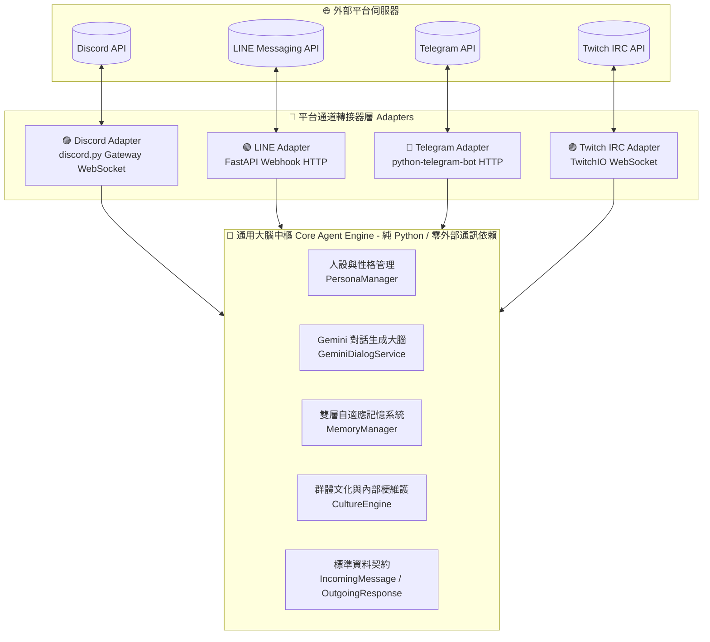
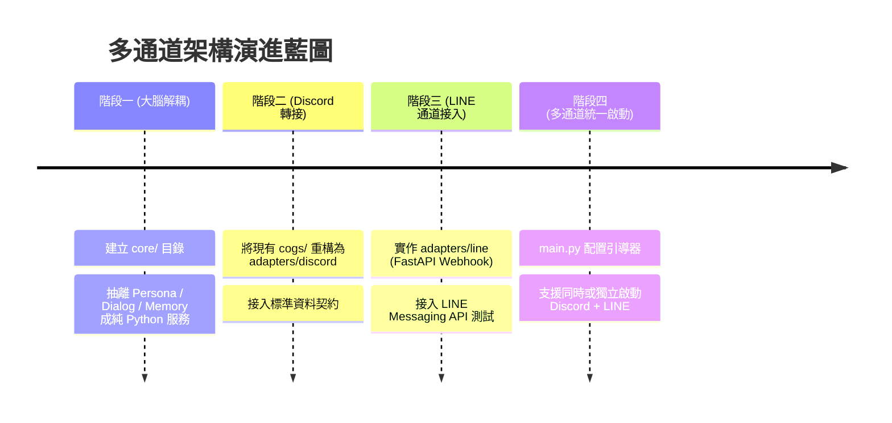

# 🌐 多通道統一 AI Agent 架構重構計畫書 (Ports & Adapters Architecture)

> **專案定位**：跨平台 AI Agent 中樞系統架構設計書 (Multi-Channel Unified Agent Blueprint)  
> **適用平台**：Discord (現有)、LINE (即將接入)、Telegram、Twitch 聊天室...等任意第三方通訊管道  
> **核心架構模式**：**中樞轉接器模式 (Hub & Spoke / Hexagonal Architecture)**  
> **目標**：將「AI 大腦核心（人設、記憶、對話生成）」與「特定通訊協議（Discord / LINE / Twitch）」徹底解耦，達到**人設與記憶單一真理來源 (Single Source of Truth)**，並支援各通道**獨立插拔、統一管理、彈性啟用**。

---

## 🏛️ 1. 架構願景與核心設計理念



### 核心設計原則：
1. **單一核心真理 (Single Source of Truth)**：
   * 角色人設提示詞（`data/personas/*.txt`）與雙層記憶庫（`guild_cultures.json` / `user_profiles.json`）只有一份。
   * 任何記憶學習或人設調整，所有平台即時同步受惠。
2. **依賴倒置與介面標準化 (Dependency Inversion)**：
   * 核心大腦（Core）**絕對不 import `discord` 或 `linebot`**。
   * 平台轉接器（Adapter）負責將平台特有事件轉為標準資料契約 `IncomingMessage`，並將核心大腦回傳的 `OutgoingResponse` 轉為平台的原生訊息（如 Discord 貼圖、LINE Flex Message、Twitch 簡短彈幕）。
3. **通道獨立插拔 (Plug & Play)**：
   * 可透過環境變數或設定檔決定要同時開啟哪些通道（例如：`ENABLED_CHANNELS=discord,line`），任一通道斷線或崩潰絕不影響其他通道。

---

## 📁 2. 目標專案目錄結構

```text
dc_auto_bot/
├── core/                               # 🧠 通用大腦核心 (純 Python 業務邏輯)
│   ├── models/
│   │   ├── incoming.py                 # 標準化接收訊息契約 (IncomingMessage)
│   │   └── outgoing.py                 # 標準化回傳訊息契約 (OutgoingResponse, Emotion, Assets)
│   ├── persona_service.py              # 人設載入、快取、喚醒詞匹配
│   ├── memory_service.py               # 雙層記憶系統 (群組文化、內部梗淘汰、用戶畫像)
│   ├── dialog_service.py               # Gemini Flash 對話生成、Prompt 組裝
│   └── context_manager.py              # 時間感知、歷史對話滑動窗口管理
│
├── adapters/                           # 🔌 各平台轉接器 (處理各自的 SDK 與網路協議)
│   ├── base.py                         # 轉接器抽象基類 (BaseAdapter)
│   ├── discord/                        # 🟣 現有的 Discord 模組遷移於此
│   │   ├── bot.py                      # Discord Client / Gateway
│   │   ├── message_converter.py        # Discord Message ➔ IncomingMessage
│   │   └── delivery.py                 # OutgoingResponse ➔ Discord Send / Embed / 貼圖
│   ├── line/                           # 🟢 未來新增的 LINE Webhook 模組
│   │   ├── webhook_router.py           # FastAPI Webhook 端點
│   │   ├── message_converter.py        # LINE Event ➔ IncomingMessage
│   │   └── delivery.py                 # OutgoingResponse ➔ ReplyToken / PushMessage
│   ├── twitch/                         # 🟣 未來的 Twitch 聊天室模組
│   └── telegram/                       # 🔵 未來的 Telegram 模組
│
├── data/                               # 💾 永續化資料 (所有通道共享)
│   ├── personas/                       # 角色設定文字檔
│   ├── guild_cultures.json             # 群體文化與內部梗
│   └── user_profiles.json              # 使用者個人特徵記憶
│
├── assets/emotions/                    # 🎨 共享情緒貼圖 (PNG)
├── config.py                           # 集中配置各通道的金鑰與開關
└── main.py                             # 統籌引導器 (依設定啟動指定通道)
```

---

## 🧩 3. 核心資料契約 (Data Contract) 設計

這是解耦最關鍵的「共通語言」：

### 3.1. 標準輸入訊息 (`core/models/incoming.py`)
```python
from dataclasses import dataclass
from typing import Optional, List, Any
import datetime

@dataclass
class IncomingMessage:
    channel_type: str                  # "discord" | "line" | "telegram" | "twitch"
    channel_id: str                    # 頻道或群組 ID
    user_id: str                       # 發言者全域唯一標識 (例: "dc_123456" 或 "line_Uabc123")
    username: str                      # 發言者顯示名稱
    text: str                          # 原始文字內容
    created_at: datetime.datetime      # 訊息發送時間 (供時間感知計算)
    is_direct_chat: bool               # 是否明確與 Bot 對話 (有 @Bot / 回覆 Bot / 命中喚醒詞 / 私訊)
    reply_target_text: Optional[str]   # 被回覆的舊訊息文字
    image_bytes: Optional[bytes]       # 附帶圖片 (多模態視覺)
    image_mime: Optional[str]          # 圖片 MIME
    raw_event: Optional[Any]           # 原生平台物件 (供特殊場景備用)
```

### 3.2. 標準輸出回應 (`core/models/outgoing.py`)
```python
from dataclasses import dataclass
from typing import Optional

@dataclass
class OutgoingResponse:
    reply_text: str                    # AI 生成的角色純文字台詞
    emotion: Optional[str]             # 角色情緒標籤 (thinking / happy / angry ...)
    reaction_emoji: Optional[str]      # 若決定按表情反應 (例: "😂" 或 "cmonBruh")
    target_message_id: Optional[str]   # 回覆目標訊息 ID
```

---

## 🔄 4. 多平台資料隔離與使用者記憶對齊機制

跨平台接入時，最核心的問題在於：**「群組與使用者 ID 如何對應？」**

1. **使用者命名空間隔離 (User Namespace)**：
   * 格式：`{channel_type}_{user_id}`
   * 例如：Discord 群友存為 `dc_123456789`，LINE 群友存為 `line_Uabcdef1234`。
   * 如此能保證在 `user_profiles.json` 中，不同平台的使用者記憶永不衝突。
2. **群組文化對應 (Guild / Chatroom Scope)**：
   * Discord 伺服器群組 ➔ `guild_id`。
   * LINE 多人群組 ➔ `groupId`。
   * Twitch 實況頻道 ➔ `broadcaster_id`。
   * 各平台群組皆擁有獨立的文化記憶與專屬內部梗。

---

## 🚀 5. 分階段重構實施藍圖 (Phased Migration Roadmap)

為確保在改造過程中**現有的 Discord 機器人零停機、功能零倒退**，規劃以下 4 個演進階段：



### 階段一：建立通用大腦核心 (`core/`)（風險：🟢 低）
* 將現有 `utils/` 中的邏輯升級為無平台依賴的純 Python 模組：
  * `core/dialog_service.py`（Gemini 提示詞組裝與 API 呼叫）
  * `core/memory_service.py`（雙層記憶維護與 Inside Jokes 淘汰）
  * `core/persona_service.py`（人設載入與喚醒詞匹配）

### 階段二：Discord 轉為轉接器模組（風險：🟡 中）
* 將現有的 `cogs/ai_roleplay.py` 改為 `adapters/discord/`。
* 負責監聽 Discord Gateway，將事件打包為 `IncomingMessage` 丟給 `core`，拿到 `OutgoingResponse` 後調用 Discord API 發送。
* 驗證：確保現有的 Discord Bot 所有功能（對話、看圖、貼圖、記憶、喚醒詞）100% 正常。

### 階段三：實作 LINE 轉接器 (`adapters/line/`)（風險：🟢 低 / 全新模組）
* 使用專案現有的 `FastAPI` 伺服器建立 `/callback` Webhook 端點。
* 接收 LINE 的 `TextMessage`，轉換為 `IncomingMessage` 送給 `core` 大腦。
* 將大腦產生的台詞以 LINE Reply Message 送回給 LINE 使用者。

### 階段四：統一啟動與設定（風險：🟢 低）
* 在 `config.py` 與 `main.py` 整合通道切換器，可靈活配置：
  * 只跑 Discord
  * 只跑 LINE
  * 同時跑 Discord + LINE

---

## 🧪 6. 驗證計畫

1. **核心純度檢驗 (Core Purity Test)**：
   * 撰寫獨立的測試腳本 `tests/test_core_brain.py`，**完全不啟動任何 Bot**，直接向 `core` 丟入模擬的 `IncomingMessage`，確認能正確輸出有情緒、有記憶的角色回應。
2. **多通道獨立性驗證**：
   * 同時啟動 Discord 與 LINE 通道。
   * 人為將 LINE 網路切斷，確認 Discord 通道完全不受影響，依然正常互動。
3. **記憶獨立性驗證**：
   * 在 Discord 群組累積內部梗，確認只寫入該 Discord 群組文化；LINE 群組亦有專屬的群組文化，彼此乾淨隔離。
