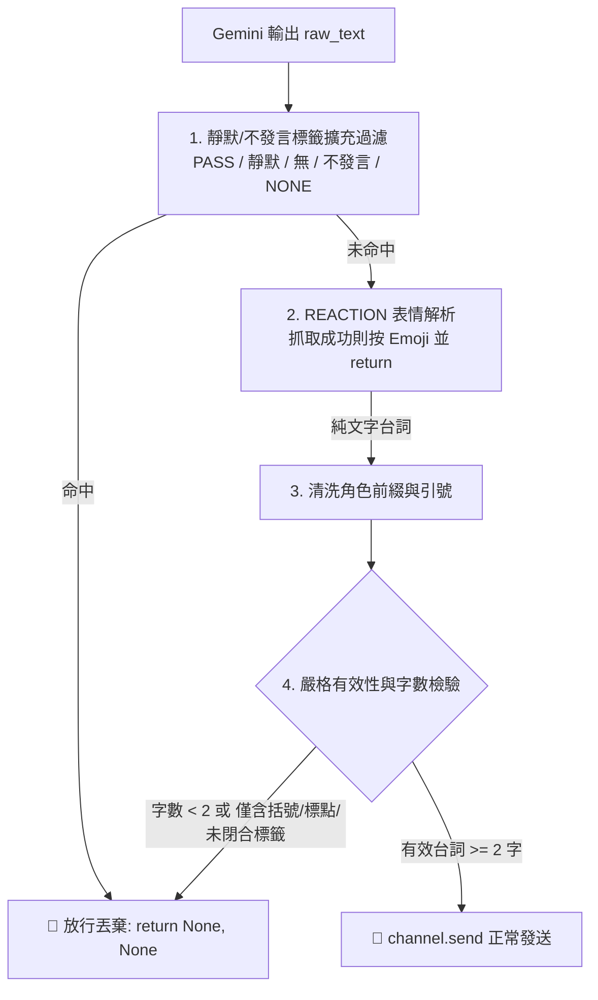

# 🐛 主動插話只輸出單一中括號 `[` 根本原因與深度防護修復指南

> **專案**：`dc_auto_bot`  
> **目標模組**：[`utils/spontaneous_engine.py`](file:///d:/OneDrive/tools/dc_auto_bot/utils/spontaneous_engine.py)、[`utils/message_delivery.py`](file:///d:/OneDrive/tools/dc_auto_bot/utils/message_delivery.py)  
> **問題現象**：在 Discord 頻道中，Bot 觸發主動插話時，頻道裡只收到單一個字元 `[`，沒有任何實際對話台詞。  
> **文件用途**：供後續對話或開發者直接依循此修復指南修改 Python 原始碼。

---

## 📌 1. 根本原因深入剖析 (Root Cause)

### 1.1. 安全防護正則存在邏輯死角 (The `[` Edge Case)
在 `utils/spontaneous_engine.py` 第 130 行：
```python
# 舊防護程式碼：
if not clean_text or (clean_text.startswith("[") and clean_text.endswith("]")):
    return None, None
```
* **致命漏洞**：當 `clean_text` **剛好只有單一個字元 `[`** 時：
  * `clean_text.startswith("[")` ➔ **`True`**
  * `clean_text.endswith("]")` ➔ **`False`**（因為最後一個字元是 `[`，不是 `]`！）
  * 結果：`True and False` 判定為 **`False`**！防護機制完全失效，直接將 `[` 當作台詞傳給了 `channel.send("[")`！

### 1.2. Gemini 為何會生成 `[` 或未閉合標籤？
提示詞中列出了所有中括號格式選項：`[PASS]`、`[REACTION: xxx]`、`[EMOTION: xxx]`。
* 當 Gemini 判定為不發言時，偶爾會輸出自創標籤（如 `[無]`、`[不發言]`、`[靜默]`、`[旁聽]`、`[無動作]`、`[PASS: 不需要插話]`）。
* 或者在串流/Token 生成邊界中只吐出了開頭的 `[`，由於上述防護死角未攔截，導致殘留的單一括號被直接推送到 Discord。

---

## 🛠️ 2. 具體修復方案 (多重嚴密防護)



---

## 💻 3. 代碼修改規格 (Diff)

### 檔案 1：[`utils/spontaneous_engine.py`](file:///d:/OneDrive/tools/dc_auto_bot/utils/spontaneous_engine.py)
在 `generate_spontaneous_decision` 強化標籤攔截與字數防護：

```diff
         try:
             response = await asyncio.to_thread(
                 ai_client.models.generate_content,
                 model=config.GEMINI_MODEL,
                 contents=prompt,
                 config=types.GenerateContentConfig(
                     system_instruction=spontaneous_instruction,
                     temperature=0.7,
                     max_output_tokens=200
                 )
             )
             raw_text = (response.text or "").strip()
-            if not raw_text or re.search(r"\[PASS\]", raw_text, re.IGNORECASE):
+            # 1. 攔截所有靜默/放棄標籤 (PASS, 靜默, 無, 不發言, NONE, SILENCE 等)
+            silent_patterns = r"\[(PASS|SILENCE|NONE|SKIP|無|靜默|不發言|不插話|無動作|旁聽|忽略)[^\]]*\]"
+            if not raw_text or re.search(silent_patterns, raw_text, re.IGNORECASE) or raw_text.lower() in ["pass", "none", "skip", "null"]:
                 return None, None
 
             # 若為表情反應標籤，直接回傳讓 handler 處理
             if re.search(r"\[REACTION:\s*[^\]]+\]", raw_text, re.IGNORECASE):
                 return raw_text, None
 
             # Parse emotion tag if present
             clean_text, emotion = MessageDeliveryService.extract_emotion_tag(raw_text)
 
             # 清理可能的角色名稱前綴 (例: "[莫寧]: " 或 "莫寧: ") 與包裹引號
             clean_text = MessageDeliveryService.clean_speech_text(clean_text)
 
-            # 安全防護：若清洗後只剩括號或無效文字則放棄
-            if not clean_text or (clean_text.startswith("[") and clean_text.endswith("]")):
+            # 2. 嚴密防護死角：剔除單獨括號、未閉合標籤、純標點符號或字數過短 (< 2 字)
+            if not clean_text or len(clean_text) < 2:
+                return None, None
+            if clean_text in ["[", "]", "()", "[]", "【】", "「」", "''", '""', "..."]:
+                return None, None
+            if clean_text.startswith("[") and (clean_text.endswith("]") or "]" not in clean_text):
                 return None, None
 
             return clean_text, emotion
```

---

### 檔案 2：[`utils/message_delivery.py`](file:///d:/OneDrive/tools/dc_auto_bot/utils/message_delivery.py)
升級 `clean_speech_text`，支援中文全形冒號與開頭括號動作清洗：

```diff
     @staticmethod
     def clean_speech_text(text: str) -> str:
-        """Clean character prefixes (e.g., '[莫寧]: ') and surrounding quotes from generated text."""
-        clean = re.sub(r"^\[?[^:\]\n]+\]?:\s*", "", text).strip()
+        """Clean character prefixes (e.g., '[莫寧]: ', '[莫寧：]') and surrounding quotes from generated text."""
+        # 清除中英文冒號之角色前綴 (例: "[莫寧]: ", "莫寧：", "【愛莉】:")
+        clean = re.sub(r"^\[?[^:：\]\n]+\]?[:：]\s*", "", text).strip()
+        # 清除開頭無冒號之單純角色名中括號 (例: "[莫寧] ")
+        clean = re.sub(r"^\[(?:莫寧|愛莉|達妮婭|愛彌斯|梨諾|Airi|Mornye|Aemeath|Daniya|Liino)\]\s*", "", clean, flags=re.IGNORECASE).strip()
         clean = clean.strip("\"'「」")
         return clean
```

---

## 🧪 4. 測試與驗證清單

| 測試案例 | 模擬 Gemini 輸出 | 預期修復後表現 |
| :--- | :--- | :--- |
| **1. 單一括號死角** | `[` 或 `]` | 觸發 `len < 2` 與括號防護 ➔ **`return None, None`**，Discord 絕不發送。 |
| **2. 自創靜默標籤** | `[不插話]` 或 `[PASS: 正在排錯]` | 命中 `silent_patterns` ➔ **`return None, None`**，安靜放行。 |
| **3. 全形冒號前綴** | `[莫寧：] 漂泊者，早安。` | 清洗前綴 ➔ Discord 收到乾淨的 `漂泊者，早安。`。 |
| **4. 正式正常台詞** | `今天天氣真不錯呢！` | 正常通過 ➔ Discord 收到 `今天天氣真不錯呢！`。 |
