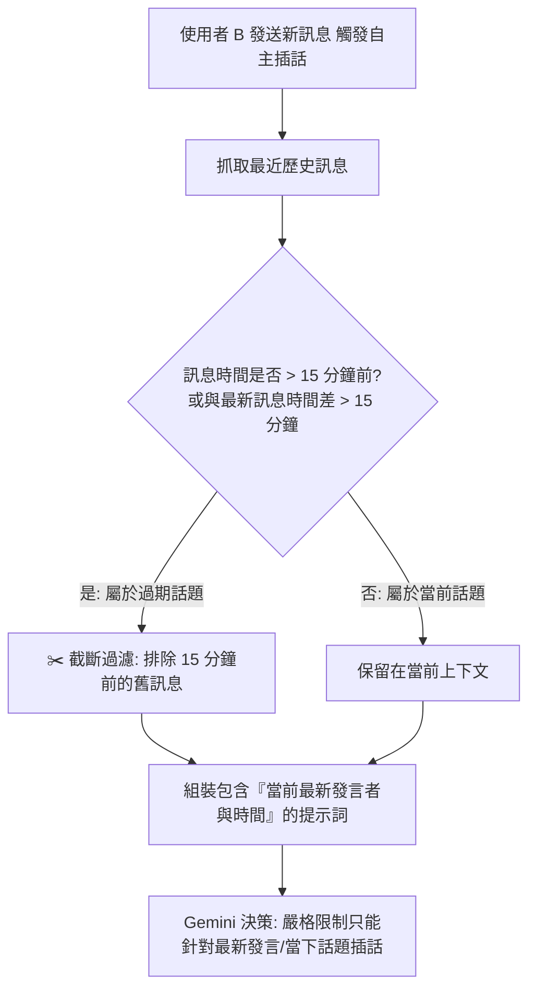

# ⏱️ 主動插話「歷史過期話題誤回 (2小時前死灰復燃)」修復指南

> **專案**：`dc_auto_bot`  
> **目標模組**：[`cogs/ai_roleplay.py`](file:///d:/OneDrive/tools/dc_auto_bot/cogs/ai_roleplay.py)  
> **問題描述**：使用者 A 在 2 小時前發言提及 Bot 名字（未 @），Bot 當時未回覆。2 小時後使用者 B 發送了完全無關的新訊息，Bot 突然自主插話去回覆使用者 A 兩小時前的發言。  
> **文件用途**：供後續對話或開發者直接依循此修復指南修改 Python 原始碼。

---

## 📌 1. 根本原因深入剖析 (Root Cause)

### 1.1. 上下文無時間標籤 (Time Blindness)
* `fetch_recent_channel_context` 透過 `channel.history(limit=30)` 抓取歷史訊息時，只輸出：
  ```text
  [使用者 A]: 莫寧你覺得這個好用嗎？
  [使用者 B]: 早安
  ```
* **問題**：上下文文字中**完全沒有時間戳記**。Gemini 無法得知使用者 A 的訊息是 **2 小時前** 發送的，而使用者 B 是 **3 秒前** 發送的。在 AI 看來，這兩句話像是同一秒鐘連續講的。

### 1.2. 缺少「會話過期斷層過濾 (Session Staleness Gap)」
* 在社群聊天中，如果兩則訊息之間間隔超過 **15 ~ 20 分鐘**，代表**前一個話題已經散場/結束**。
* 目前的程式碼不管間隔多久，只要未滿 30 條就全部打包，導致 2 小時甚至昨天未解答的閒聊被當成「當前正在進行的話題」。

### 1.3. 決策焦點未鎖定「最新發言」
* 提示詞中只寫了「請根據以上對話紀錄決定動作」，Gemini 看到歷史紀錄裡有一條「指名問 Bot 且尚未被回答」的使用者 A 訊息，加上使用者 B 只發了簡短的早安，Gemini 便自作聰明地去「補回答」使用者 A 兩小時前的問題。

---

## 🛠️ 2. 具體修復方案 (三大防護機制)



---

## 💻 3. 代碼修改規格 (Diff)

### 檔案：[`cogs/ai_roleplay.py`](file:///d:/OneDrive/tools/dc_auto_bot/cogs/ai_roleplay.py)

#### 3.1. 在 `fetch_recent_channel_context` 增加時間斷層過濾 (`max_age_minutes`)
```diff
     async def fetch_recent_channel_context(
         self,
         channel: discord.abc.Messageable,
         current_message_id: Optional[int] = None,
-        fetch_images: bool = False
+        fetch_images: bool = False,
+        max_age_minutes: Optional[int] = None
     ) -> tuple[str, list[types.Part]]:
         """Fetch recent messages from the channel for ambient context.
         
         Skips the triggering message itself to avoid duplication.
+        If max_age_minutes is provided, ignores messages older than max_age_minutes from now
+        or stops at the first conversational silence gap (> 20 mins).
         """
         if not hasattr(channel, "history"):
             return "", []
 
         fetched_items = []
         empty_count = 0
+        now_utc = discord.utils.utcnow()
         try:
             before_obj = None
             if current_message_id:
                 before_obj = discord.Object(id=current_message_id)
 
             async for msg in channel.history(limit=30, before=before_obj):
                 # Keep our Bot's own messages, but skip third-party automated system bots
                 if msg.author.bot and msg.author != self.bot.user:
                     continue
 
+                # 時間過期與話題斷層過濾 (若指定了 max_age_minutes)
+                if max_age_minutes:
+                    msg_age = (now_utc - msg.created_at).total_seconds() / 60
+                    if msg_age > max_age_minutes:
+                        # 遇到超過時間門檻的舊話題，直接中斷往前回溯
+                        break
+
                 clean = re.sub(r'<@!?\d+>', '', msg.content).strip() if msg.content else ""
```

---

#### 3.2. 修復 `handle_spontaneous_chime_in` 與 `generate_spontaneous_response`
在自主插話時，**只讀取最近 15 分鐘內的對話**，並在 Prompt 中明確指明「當前最新發言者」與「禁止回覆過期舊話題」：

```diff
     async def handle_spontaneous_chime_in(self, trigger_message: discord.Message):
         """Handle background spontaneous chime-in / reaction decision and action."""
         channel = trigger_message.channel
         guild_id = trigger_message.guild.id if trigger_message.guild else None
         user_id = trigger_message.author.id
 
         # 立即進入冷卻，防止同頻道短時間內重複觸發
         self.spontaneous_cooldowns[channel.id] = time.time()
 
-        # 抓取最近 15 則聊天室動態上下文
+        # 抓取最近 15 分鐘內的當前話題上下文 (防止回覆 2 小時前的死灰話題)
         ambient_context, _ = await self.fetch_recent_channel_context(
             channel,
             current_message_id=trigger_message.id,
-            fetch_images=False
+            fetch_images=False,
+            max_age_minutes=15
         )
 
         reply_text, emotion = await self.generate_spontaneous_response(
             channel_id=channel.id,
             ambient_context=ambient_context,
             user_id=user_id,
-            guild_id=guild_id
+            guild_id=guild_id,
+            latest_message_author=trigger_message.author.display_name,
+            latest_message_content=trigger_message.content
         )
```

```diff
     async def generate_spontaneous_response(
         self,
         channel_id: int,
         ambient_context: str,
         user_id: int,
-        guild_id: Optional[int]
+        guild_id: Optional[int],
+        latest_message_author: str = "",
+        latest_message_content: str = ""
     ) -> tuple[Optional[str], Optional[str]]:
         """Call Gemini 3.7 Flash with strict decision prompt to either PASS, REACTION, or CHIME-IN."""
         if not self.ai_client:
             return None, None
 
         memory_context = memory_manager.get_combined_context(guild_id, user_id)
 
         spontaneous_instruction = (
             f"{self.persona}\n\n"
             f"{memory_context}\n\n"
             f"【目前對話情境】\n"
             f"你正在 Discord 聊天室旁聽大家的對話。\n"
+            f"【最新發言】：剛才 [{latest_message_author}] 說了：「{latest_message_content}」。\n"
             f"【自主插話與表情反應決策規則】：\n"
-            f"請根據最近的對話脈絡，判斷你是否適合「像朋友一樣自然地插嘴一句」或「給最後一則訊息按表情反應」。\n"
+            f"請只針對「當前最新進行的話題或最新這則發言」進行反應，嚴禁回覆過去已經結束或過期的話題。\n"
             f"1. 若當前話題嚴肅、正在技術排錯/認真問答、不適合打擾、或你無話可說 ➔ 請嚴格只輸出單一標籤：[PASS]\n"
             f"2. 若只想默默按表情表達情緒（搞笑/認同/驚訝/無奈） ➔ 請輸出：[REACTION: 表情名稱或Unicode] (例如 [REACTION: 😂]、[REACTION: ✨] 或自訂表情如 [REACTION: cmonBruh])\n"
             f"3. 若適合開口接梗/吐槽/插話 ➔ 請以你的人物性格輸出 1 句話 (15~35 字以內)，可附帶 [EMOTION: xxx]。\n"
         )
```

---

## 🧪 4. 測試與驗證計畫

1. **跨時段舊話題隔離測試**：
   * 使用者 A 在頻道發言：「莫寧你今天吃了嗎？」（不 @Bot），Bot 當下未插話。
   * 等待 20 分鐘以上（或模擬 2 小時後）。
   * 使用者 B 在頻道發言：「早安啊各位」。
   * **預期結果**：Bot 抓取上下文時自動將 20 分鐘前使用者 A 的發言剔除，Bot **絕不會**去回答 2 小時前使用者 A 的問題，若要插話只會針對使用者 B 的早安進行簡短問候或按 Emoji 反應。
2. **同話題連續對話插話測試**：
   * 多位群友在 5 分鐘內連續討論熱門話題。
   * **預期結果**：5 分鐘內的對話完整保留在上下文中，AI 能精準理解當前笑點並自然接梗。
