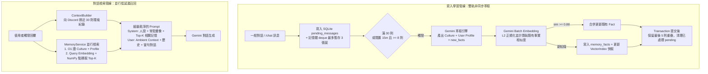

# 🧠 記憶系統重構與輕量向量檢索升級計畫書（方案 D：SQLite + NumPy + Persona 隔離）

> **專案**：`dc_auto_bot`  
> **定位**：純架構分析與重構規劃文件（尚未修改程式碼）  
> **技術選型**：`aiosqlite`（持久化與關聯查詢）+ `numpy`（記憶體內 L2 正規化餘弦點積）+ Gemini Embedding API（複用 `google-genai`）  
> **目標環境**：GCP GCE `e2-micro` (1GB RAM) / `e2-small` (2GB RAM) 單容器 Docker (`python:3.11-slim`)，持久化目錄 `./data:/app/data`

---

## 📌 1. 核心決策與設計原則

根據討論確認的四項核心方向：

1. **向量檢索引擎採「方案 D」**：不使用重型本地模型（PyTorch / ONNX / ChromaDB）或額外向量資料庫容器，改以單一 `data/memory.db`（`aiosqlite`）儲存事實與向量 `BLOB`，並以極輕量 `numpy` 矩陣計算相似度。
2. **依 Persona 分離記憶**：切換角色（`/chg_persona`）後，各角色擁有獨立的使用者畫像、互動事實與記憶視角。
   * **細節設計（雙作用域可調）**：`user_profiles` 與 `memory_facts` 強制綁定 `persona_id`（避免角色記憶錯亂）；`guild_cultures`（群組客觀氛圍與內部梗）預設亦依 `persona_id` 分離（各自解讀群組文化），同時在 Schema 中保留設定開關可選擇群組文化是否跨角色共享。
3. **API 額度與延遲最佳化**：
   * 一般群聊（未觸發 AI 回覆）**完全不打 Embedding API**。
   * 僅在真正觸發回覆時，為當前使用者訊息計算 1 次 Query Embedding，且與 Discord `ContextBuilder.fetch_recent_channel_context` 使用 `asyncio.gather` **平行執行**。
   * 寫入階段僅於滿 30 則或閒置 15 分鐘批次萃取時，才為提煉出的少數新事實（`new_facts`）呼叫批次 Embedding。
4. **全面清除既有技術債**：同步修復盤點出的 `_idle_check_worker` 未啟動、`guild_id` 型別不一致（`int` vs `str`）、`/reset_chat` 無法清空歷史、DM 跨用戶共用 `"DM"`、重啟/失敗遺失緩衝訊息等缺陷。

---

## 🏗️ 2. 針對「方案 D」更佳的重構做法（進階架構設計）

在方案 D 的前提下，單純把 `utils/memory_manager.py` 與 `core/agent_engine.py` 合併還不夠好；以下五項設計能讓「SQLite + NumPy 向量索引」在 1GB RAM 與非同步環境中發揮最佳穩定度與效能：

### 2.1. 徹底消除雙單例與 Import-Time 副作用，改採「元件拆分 + 依賴注入」
* **現況問題**：目前 [utils/memory_manager.py](file:///d:/OneDrive/Project/dc_auto_bot/utils/memory_manager.py) 在模組匯入時直接實例化 `memory_manager = MemoryManager()`，而 [core/agent_engine.py](file:///d:/OneDrive/Project/dc_auto_bot/core/agent_engine.py) 又各自建了一個 `MemoryService()`。在方案 D 下，若記憶體內存有向量快取，**雙實例會導致快取與 DB 不同步或重複計算**。
* **更佳做法**：將記憶核心拆為 4 個單一職責的內聚元件，並由 Discord Cog / App 生命週期統一管理唯一實例：
  1. **`MemoryStore`（SQLite WAL 資料存取層）**：專責 `aiosqlite` 連線（啟用 `PRAGMA journal_mode=WAL`）、建表、CRUD 與一次性 JSON 遷移。
  2. **`EmbeddingService`（向量化與降級層）**：封裝 `google-genai` Embedding API 呼叫、L2 正規化（Normalized to unit vector），以及 API 異常時的**安全降級**（Embedding 失敗時回傳 `None`，對話流程仍照常運作，只暫時省略向量回憶）。
  3. **`VectorIndex`（按區分片的記憶體向量快取）**：依 `(persona_id, scope_key)` 分區快取 `float32` 正規化矩陣與對應 `fact_id` 清單。支援 **Lazy Load（首次查到某分區才從 SQLite 載入）** + **Write-Through（新增/更新/刪除同步刷新快取）** + **LRU 容量上限**（防止長期運行下 RAM 無限增長）。
  4. **`MemoryService`（對外統一門面 Facade）**：統籌訊息緩衝、背景雙軌萃取、混合檢索打分與管理操作。
* **生命週期對齊 [cogs/youtube.py](file:///d:/OneDrive/Project/dc_auto_bot/cogs/youtube.py)**：在 `AIRoleplayCog.cog_load()` 中呼叫 `await memory_service.initialize()`（開 DB、遷移舊 JSON、啟動 `_idle_check_worker`），在 `cog_unload()` 呼叫 `await memory_service.close()`；同時透過建構子注入給 `GeminiDialogService`，移除 [utils/gemini_dialog_service.py#L54](file:///d:/OneDrive/Project/dc_auto_bot/utils/gemini_dialog_service.py#L54) 內部的延遲全域 import。

### 2.2. `channel_histories` 與 `ambient_context` 解耦（把 Token 空間讓給向量記憶）
* **現況問題**：目前 [core/dialog_service.py#L98-L112](file:///d:/OneDrive/Project/dc_auto_bot/core/dialog_service.py#L98-L112) 直接將現撈的 30 則 `ambient_context` 與歷史圖片寫死進 `channel_histories[channel_id]`，導致多輪歷史重複堆疊好幾份近況快照。
* **更佳做法**：
  * `channel_histories` 僅儲存乾淨的「當輪使用者對話 + 該輪直接附圖」與「AI 回覆」。
  * 「現撈 30 則 `ambient_context`」與「檢索出的 Top-K 向量記憶」僅在每次 `generate_content` 組裝請求時動態注入（前者可作為當次暫時性前導訊息或獨立段落，不寫入永久歷史），省下的大量 Token 剛好完全吸收新增向量記憶的上下文開銷。

### 2.3. 緩衝區持久化 (`pending_messages`) + 成功提交後才清批
* **現況問題**：[core/memory_service.py#L146-L147](file:///d:/OneDrive/Project/dc_auto_bot/core/memory_service.py#L146-L147) 在打 Gemini API **前**就截斷 `message_buffers`，失敗即永久遺失 25+ 則聊天脈絡；重啟也會遺失記憶體緩衝區。
* **更佳做法**：
  * 將每則文字訊息同步/批次寫入 SQLite `pending_messages` 表（標記 `channel_id`、`scope_key`、`user_id`、`username`、`content`、`created_at`）。
  * **圖片不寫入 SQLite**（節省磁碟與 I/O），改保留輕量 `collections.deque(maxlen=3)` 在記憶體中為每個頻道快取最新 3 張圖片 bytes，從根源控管 1GB RAM 主機的記憶體峰值。
  * 背景萃取採用「**先算後清**」：只有 Gemini JSON 解析成功、Embedding 生成並完成 SQLite Transaction 寫入後，才從 `pending_messages` 刪除較早的訊息並保留最後 `OVERLAP_COUNT = 5` 則作為下一批重疊上下文。

### 2.4. 預先 L2 正規化 + 維度一致性防護 (`schema_meta`)
* **數學簡化**：向量寫入 SQLite 前先在 Python 做 L2 正規化（單位向量），查詢時只需單次矩陣乘法 `similarities = matrix @ query_vec`，無需每次重算範數，1,000 筆 768 維向量的運算耗時低於 1 毫秒。
* **換模型防呆**：於 `schema_meta` 記錄當前使用的 `embedding_model` 與 `embedding_dim`。若未來切換了不同的 Embedding 模型或維度，啟動檢查能明確識別不相容舊向量並觸發重建或隔離，避免靜默維度錯誤 (`ValueError: shapes not aligned`)。

### 2.5. 寫入期語意去重 + 容量護欄 (防止記憶膨脹與撞梗)
* **寫入期合併 (Write-Time Consolidation)**：萃取出的每條 `new_fact` 在寫入前，先與該 `(persona_id, scope_key, user_id)` 既有向量比對：
  * 若最高相似度 `>= 0.88`（代表同件事的更新或重複提及，如「還是很喜歡吃拉麵」或「考試從週五改到下週一」），**原地更新該筆 Fact 的文字、重要度與 `updated_at`**，而非無止境新增重複條目。
* **每分區容量上限**：每個 `(persona_id, scope_key)` 設軟上限（例如 500 筆），超過時優先清理「低重要度（`importance <= 2`）、長時間未被喚起（`last_recalled_at` 最舊）且非核心長期事實」的舊記錄，確保多年運行下效能與記憶體仍維持線性可控。

---

## 🗄️ 3. SQLite 資料表設計 (`data/memory.db`)

> 統一 Key 規範：一律使用正規化字串：
> * `persona_id`：由檔名標準化，例如 `persona_aemeath.txt` ➔ `"aemeath"`（或保留對應表）。
> * `scope_key`：群組頻道所屬伺服器為 `"discord_guild:<guild_id>"`；私訊改為 `"discord_dm:<user_id>"`（徹底解決所有私訊用戶共用 `"DM"` 記憶的隱私問題）；未來擴充 LINE 時可自然延伸為 `"line_group:<group_id>"` / `"line_user:<user_id>"`。
> * `user_id`：`"discord:<user_id>"`（相容未來多平台）。

### 核心資料表結構

1. **`schema_meta`**
   * `key TEXT PRIMARY KEY`, `value TEXT NOT NULL`
   * 存放 `schema_version`、`embedding_model`、`embedding_dim`、`json_migrated_at`。

2. **`guild_cultures`（群組常駐文化記憶）**
   * `persona_id TEXT NOT NULL`
   * `scope_key TEXT NOT NULL`
   * `group_vibe TEXT DEFAULT ''`
   * `inside_jokes_json TEXT DEFAULT '[]'`（仍維持 3～6 個精選內部梗動態汰換）
   * `speech_style TEXT DEFAULT ''`
   * `updated_at REAL NOT NULL`
   * `PRIMARY KEY (persona_id, scope_key)`

3. **`user_profiles`（個人常駐印象畫像）**
   * `persona_id TEXT NOT NULL`
   * `user_id TEXT NOT NULL`
   * `username TEXT DEFAULT ''`
   * `speaking_style TEXT DEFAULT ''`
   * `traits_and_interests TEXT DEFAULT ''`
   * `updated_at REAL NOT NULL`
   * `PRIMARY KEY (persona_id, user_id)`

4. **`memory_facts`（L3 向量事件/事實記憶）**
   * `id INTEGER PRIMARY KEY AUTOINCREMENT`
   * `persona_id TEXT NOT NULL`
   * `scope_key TEXT NOT NULL`
   * `user_id TEXT`（若為群組共同事件可為特定發起者或 `NULL`）
   * `fact_text TEXT NOT NULL`（例：`[阿明] 養了一隻叫豆漿的橘貓`）
   * `category TEXT DEFAULT 'general'`（`preference` / `event` / `relationship` / `goal` / `general`）
   * `importance INTEGER DEFAULT 3`（1～5 分）
   * `embedding BLOB NOT NULL`（L2 正規化 `float32` `ndarray.tobytes()`）
   * `embedding_dim INTEGER NOT NULL`
   * `created_at REAL NOT NULL`
   * `updated_at REAL NOT NULL`
   * `last_recalled_at REAL`
   * `recall_count INTEGER DEFAULT 0`
   * 索引：`INDEX idx_facts_partition ON memory_facts (persona_id, scope_key, updated_at DESC)`

5. **`pending_messages`（跨重啟安全的學習緩衝區）**
   * `id INTEGER PRIMARY KEY AUTOINCREMENT`
   * `channel_id TEXT NOT NULL`
   * `scope_key TEXT NOT NULL`
   * `user_id TEXT NOT NULL`
   * `username TEXT NOT NULL`
   * `content TEXT NOT NULL`
   * `has_image INTEGER DEFAULT 0`
   * `created_at REAL NOT NULL`
   * 索引：`INDEX idx_pending_channel ON pending_messages (channel_id, id)`

---

## 🔄 4. 目標執行流程（讀寫雙管線）

### 綜合召回評分公式（避免只搜到「很像但過時」的記憶）
讀取 `memory_facts` 時，對候選向量先做最小相似度過濾（例如 `cosine >= 0.45`），再計算綜合分數取 Top 5：
$$\text{Score} = 0.65 \times \text{CosineSim} + 0.20 \times \text{RecencyDecay} + 0.15 \times \frac{\text{Importance}}{5}$$
* `RecencyDecay`：依 `updated_at` 距今經過天數指數衰減（例如半衰期 30 天），讓近期事件更容易優先浮現，但高重要度長期事實（如重要喜好、人物關係）仍不會輕易掉出檢索結果。

---

## 📁 5. 模組改造與檔案影響範圍

| 檔案 / 模組 | 變更性質 | 核心調整內容 |
| :--- | :--- | :--- |
| `requirements.txt` | 修改 | 新增 `numpy>=1.26.0` |
| `config.py` / `.env.example` | 修改 | 新增 `GEMINI_EMBEDDING_MODEL`、`MEMORY_EMBEDDING_DIM`、`MEMORY_TOP_K`、`MEMORY_ISOLATE_GUILD_BY_PERSONA` 等可調參數 |
| `core/memory/`（新增子套件） | 新增 | 拆分為 `store.py` (`MemoryStore`)、`embeddings.py` (`EmbeddingService`)、`vector_index.py` (`VectorIndex`)、`models.py` |
| `core/memory_service.py` | 重構 | 保留公開介面並改為統籌上述元件的 Facade；修復 `int`/`str` key、DM 隔離、安全清批與向量 Hybrid Retrieval |
| `utils/memory_manager.py` | 重構/淘汰 | 移除匯入時全域單例建構；可轉為純轉接層或直接由 `AIRoleplayCog` 注入 `MemoryService` 實例 |
| `core/dialog_service.py` | 修改 | 1. 將 `ambient_context` 抽離 `channel_histories` 多輪儲存 2. `reset_channel_history` 統一轉 `str(channel_id)` 修復 `/reset_chat` |
| `utils/gemini_dialog_service.py` | 修改 | 改為注入 `memory_service`，以 `asyncio.gather` 平行執行 `ContextBuilder` 與向量檢索 |
| `core/agent_engine.py` | 修改 | 共用同一套 `MemoryService` 實作與標準化 `persona_id` / `scope_key` 傳遞，消除雙軌分歧 |
| `cogs/ai_roleplay.py` | 修改 | 1. 在 `cog_load` / `cog_unload` 初始化與關閉 `MemoryService`（正式啟動 `_idle_check_worker`） 2. `/chat` 納入記憶緩衝 3. 傳入 `active_persona_id` 與正確 DM `scope_key` 4. 擴充 `/view_memory` 並新增 `/forget_memory` 指令 |

---

## 🛠️ 6. 分階段實作計畫 (Phased Roadmap)

### Phase 1：儲存層與向量基礎設施（零破壞性打底）
* 在 `requirements.txt` 加入 `numpy`，並在環境中確認目標 `google-genai` SDK 的 `embed_content` 參數與維度輸出。
* 建立 `core/memory/store.py`、`embeddings.py`、`vector_index.py`，完成 SQLite 建表、WAL 設定與 `float32` L2 正規化矩陣檢索。
* 撰寫**一次性舊資料遷移工具**：若偵測到既有 `data/guild_cultures.json` 或 `data/user_profiles.json`，將資料歸入當前啟用的 `active_persona`（或預設值）並正規化 key 後匯入 `data/memory.db`，將舊 JSON 備份為 `.json.bak`。

### Phase 2：記憶萃取與緩衝重構（Write Path 升級）
* 重構 `MemoryService.add_message` 與 `extract_memories`：改用 `pending_messages` 持久化緩衝、記憶體 3 圖 deque、Gemini JSON 同時萃取 `guild_culture` + `user_updates` + `new_facts`。
* 實作「批次 Embedding + 相似度 `>= 0.88` 去重更新 + 成功提交後才刪除已處理訊息」。
* 補齊 `start_idle_worker()` 至生命週期，使「閒置 15 分鐘自動萃取」正式生效。

### Phase 3：並行檢索與對話整合（Read Path + Bug 修復）
* 實作 Hybrid Retrieval（語意相似度 + 時間衰減 + 重要度）與 Prompt 組裝格式。
* 重構 `GeminiDialogService` 與 `DialogService`：
  * 平行執行 Discord 歷史抓取與向量檢索。
  * 分離 `ambient_context` 與 `channel_histories`（降低 Token 重複消耗）。
  * 修復 `DialogService.reset_channel_history` 型別 Bug 與 DM 記憶隔離。
* 讓 `cogs/ai_roleplay.py`（包含 `on_message` 與 `/chat`）與 `core/agent_engine.py` 對接同一實例與 `persona_id` 上下文。

### Phase 4：使用者指令與可觀測性
* 更新 `/view_memory`：分頁或分欄顯示當前 Persona 下的「群組文化」、「個人常駐印象」與「最近 / 最常回憶的 Top 5 事件記憶」。
* 新增 `/forget_memory`（支持依關鍵字/ID 刪除單筆記憶，或清除本人在目前角色下的所有記憶，以及 Bot Admin 專用的群組重設選項）。
* 補齊結構化日誌（記錄每次向量命中筆數、最高相似度、檢索耗時 ms 與記憶體快取規模）。

---

## 🧪 7. 驗證與測試清單

1. **單元與數學正確性測試（可在無 Discord 環境執行）**：
   * 驗證 `VectorIndex` 的 L2 正規化與矩陣點積排序正確性、空分區安全回傳。
   * 驗證 `>= 0.88` 高相似度事實寫入時確實觸發更新而非重複插入。
   * 驗證 `DialogService.reset_channel_history` 傳入 `int` / `str` 皆可正確清除，且 `channel_histories` 不再累積多份 `ambient_context`。
2. **故障降級與持久性測試**：
   * Mock Gemini Embedding API 拋出例外或超時，確認 AI 仍能用 `Core Profile` + 短期對話正常回覆，不會影響主對話流程。
   * 寫入 10 則 `pending_messages` 後模擬重啟進程，確認重新啟動並閒置 15 分鐘後能自動接續萃取。
3. **Persona 與 DM 隔離驗證**：
   * 使用者 A 在 Persona 1 建立事實後切換至 Persona 2，`/view_memory` 與對話檢索皆不可讀到 Persona 1 的私人記憶；切回 Persona 1 後可完整召回。
   * 兩位不同使用者分別私訊 Bot，彼此的記憶互不汙染。
4. **資源與延遲基準檢查**：
   * 在目標容器實測啟用 `numpy` 後的 Image 大小與常駐 RSS 記憶體；檢查觸發回覆時的 Embedding + NumPy 檢索耗時是否在預期低延遲範圍內。
